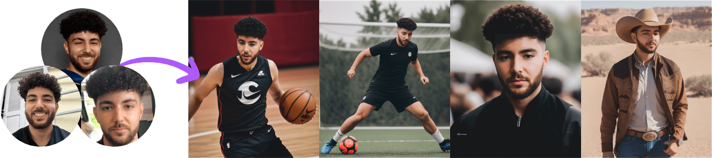
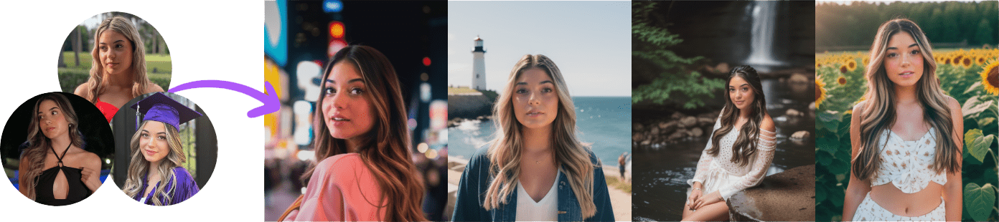
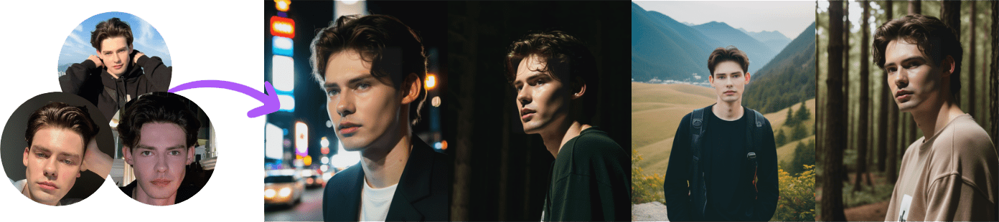
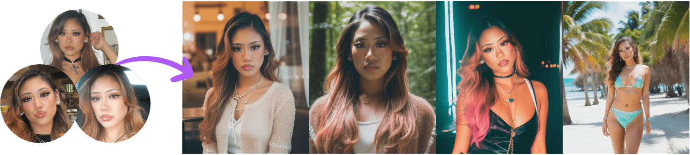
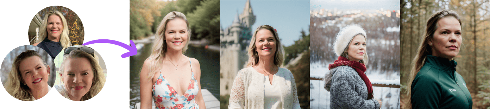
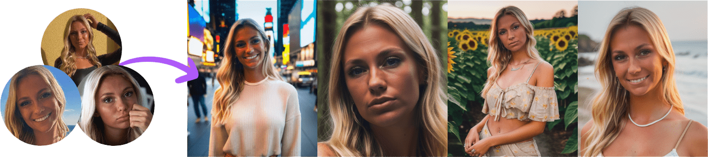
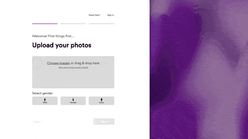
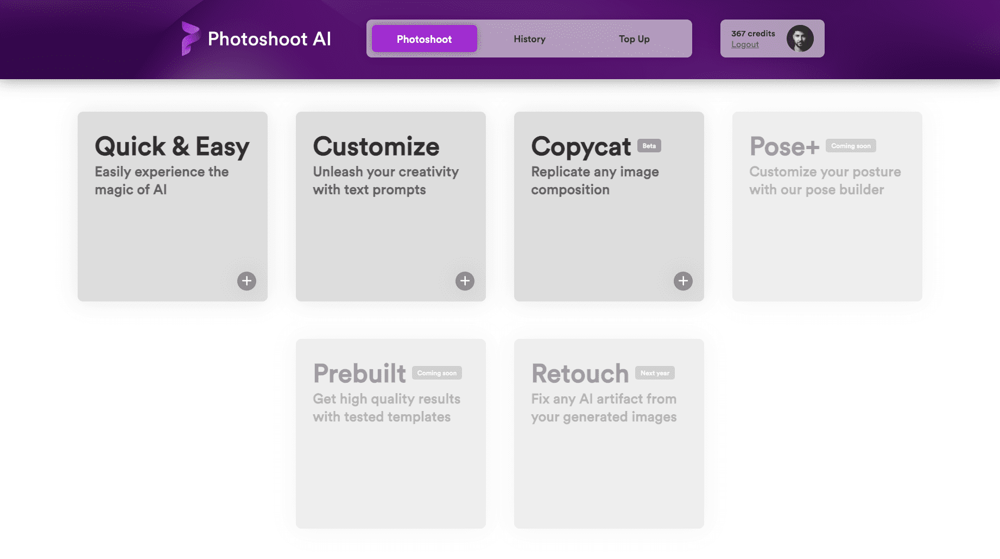
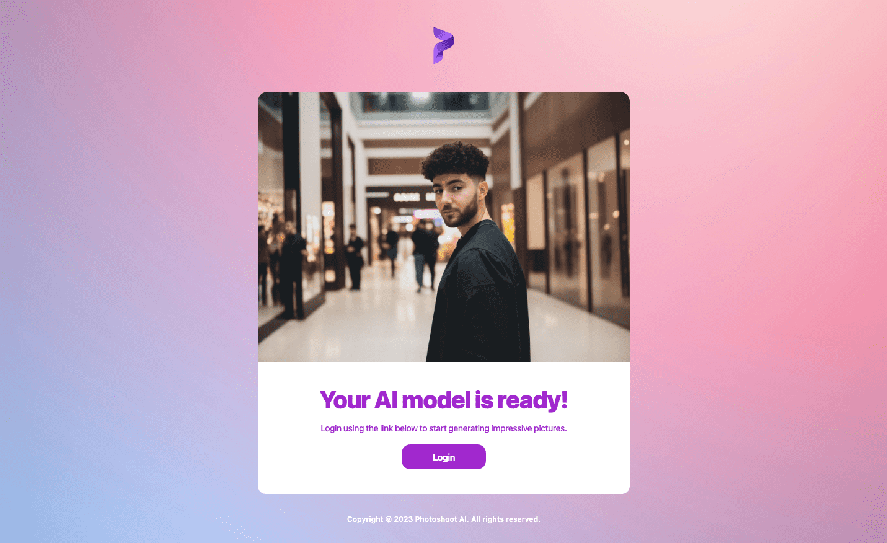

# Photoshoot AI

### Main features:

- Utilizes [Dreambooth](https://arxiv.org/abs/2208.12242), a cutting-edge approach for fine tuning text-to-image diffusion models for subject-driven generation
- Training on a [custom base model](https://huggingface.co/TahaRhidouani/photoshoot-ai/blob/main/base-model.ckpt), utilizing custom regularization images for [men](https://huggingface.co/TahaRhidouani/photoshoot-ai/blob/main/regularization-images-man.zip), [women](https://huggingface.co/TahaRhidouani/photoshoot-ai/blob/main/regularization-images-woman.zip) & [other](https://huggingface.co/TahaRhidouani/photoshoot-ai/blob/main/regularization-images-other.zip), and a custom prediction pipeline
- Provides near-infinite customizability and high quality image generation utilizing techniques such as mask in-painting, [ControlNet](https://github.com/lllyasviel/ControlNet) and smart upscaling
- Web application offers flexible and secure authentication using Google, Microsoft, Facebook or encrypted email & passwords
- Features a secure payment system utilizing Apple Pay, Google Pay, Alipay, Affirm and card input using Stripe
- Sends automated emails for password reset requests, or for timely notifications, such as alerts when the custom AI model is ready for the user
- Leverages MongoDB for efficient user data storage and AWS S3 for scalable storage of images
- Showcases a visually stunning and modern user interface, incorporating smooth animations and mobile responsivness

<br />

**Generates high quality photos from selfies**

      

<br />

**Smooth and inviting homepage**


<br />

**Easy setup process**



<br />

**Intuitive image generation UI**


<br />

**Extensive image generation dashboard**



<br />

**Automated custom emails for timely notifications**



<br />

## Run

Every push to `main` builds the image `ghcr.io/taharhidouani/photoshoot-ai` (tags `main` and `sha-<commit>`). The container listens on port 8080 and answers `GET /healthz`. The variable names are listed in `.env.template`:

| Variable | Purpose |
| --- | --- |
| `URL` | Public base URL, for example `https://photoshootai.app`; OAuth callbacks, emails and Replicate callbacks are built from it |
| `MONGO_URL` | MongoDB connection string (sessions go to the database `photoshoot-ai`) |
| `SESSION_SECRET` | Random string that signs session cookies; without it sessions reset on every restart |
| `UPLOADS_DIR` | Directory for training zips, default `/data/uploads` (created if missing) |
| `STRIPE_KEY`, `STRIPE_ENDPOINT` | Stripe secret key and webhook signing secret |
| `REPLICATE_KEY` | Replicate API token; also signs the callback URLs given to Replicate |
| `GOOGLE_CLIENT_ID`, `GOOGLE_CLIENT_SECRET`, `MICROSOFT_APPLICATION_ID`, `MICROSOFT_APPLICATION_SECRET`, `FACEBOOK_APP_ID`, `FACEBOOK_APP_SECRET` | OAuth sign-in |
| `SENDGRID_API_KEY`, `SENDGRID_MODEL_COMPLETE_TEMPLATE`, `SENDGRID_FORGOT_PASSWORD_TEMPLATE`, `SENDGRID_INACTIVE_ACCOUNT_TEMPLATE` | Emails |
| `AWS_S3_BUCKET`, `AWS_REGION`, `AWS_ACCESS_KEY_ID`, `AWS_SECRET_ACCESS_KEY` | Generated image storage |
| `DISCORD_BOT_TOKEN` | Optional, posts errors to the `error-logs` channel |

```sh
docker run -p 8080:8080 -v photoshoot-ai-data:/data --env-file photoshoot-ai.env ghcr.io/taharhidouani/photoshoot-ai:main
```

The `/data` volume must be writable by uid 1000. Register `<URL>/auth/google/callback`, `<URL>/auth/microsoft/callback` and `<URL>/auth/facebook/callback` with the OAuth providers, and `<URL>/payment-completed` as the Stripe webhook. The model training and prediction folders are not part of the image.
